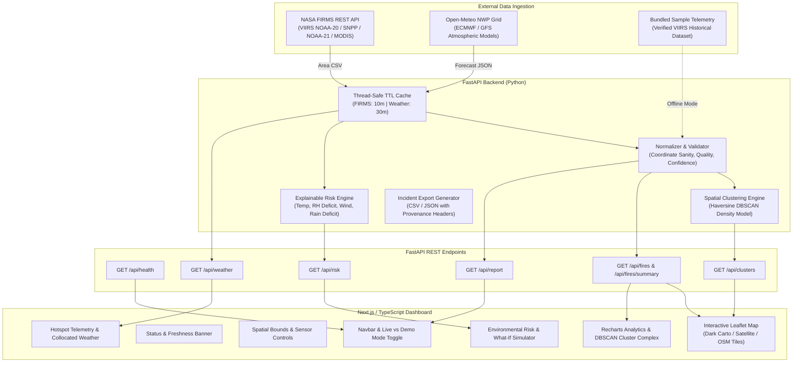

# SKYGUARD — Eyes on Earth
### Satellite-Powered Active-Fire Monitoring & Environmental Risk Prototype

[](https://fastapi.tiangolo.com)
[](https://nextjs.org)
[](https://leafletjs.com)
[](https://docs.pytest.org)
[](LICENSE)

**SKYGUARD — Eyes on Earth** is a functional space-technology and remote-sensing prototype engineered for student innovation ideathons. It ingests near-real-time active fire observations from **NASA FIRMS** (VIIRS & MODIS) and collocated atmospheric parameters from **Open-Meteo** to deliver live hotspot geospatial exploration, density-based spatial clustering, explainable environmental risk scoring, and downloadable scientific incident reporting.

---

## Architecture Diagram



---

## Key Features

1. **Dual-Mode Telemetry Stream:**
   - **Live NASA FIRMS:** Directly connects to NASA's EOSDIS servers using your free `MAP_KEY`.
   - **Demo Mode:** Uses a bundled, verified sample VIIRS dataset covering California, the Mediterranean, Australia, and the Amazon when no key is configured.
   - **No Silent Fallback:** The application maintains strict visual distinction between demo data and live satellite telemetry, alerting users if an upstream service fails.

2. **Interactive Geospatial Map:**
   - Client-side Leaflet with support for CartoDB Dark Matter, Esri World Imagery (high-resolution satellite tiles), and OpenStreetMap.
   - Confidence-scaled SVG markers (Red for High, Orange for Nominal, Amber for Low) and intensity-scaled radii based on Fire Radiative Power (MW).
   - Spatial cluster overlays showing density hulls and detection complexes.
   - Preset selector for California, Mediterranean, Amazon, Australia, Global Demo, or custom bounding box.

3. **Collocated Meteorological Telemetry:**
   - When a hotspot pixel is clicked, SKYGUARD fetches real atmospheric data from Open-Meteo (2m temperature, relative humidity, sustained wind velocity and direction, and recent precipitation).

4. **Explainable Environmental Risk Engine (0–100):**
   - **100% transparent atmospheric susceptibility score**:
     - **Relative Humidity Deficit (35% weight):** Critical fine dead fuel desiccation driver.
     - **Surface Air Temperature (25% weight):** Vapor pressure deficit and thermal preheating.
     - **Sustained Wind Speed (25% weight):** Flame front propagation and convective oxygen supply.
     - **Precipitation Deficit (15% weight):** Lack of recent rainfall (&lt; 5mm) elevating flammability.
   - **Interactive What-If Simulator:** Real-time sliders allow researchers to simulate heatwave, dry wind, or rainfall scenarios.
   - **Input Resilience:** Handles missing meteorological variables gracefully through dynamic weight re-normalization without inventing synthetic values.

5. **Spatial Density Clustering:**
   - DBSCAN implementation using great-circle Haversine distances to aggregate nearby thermal pixels into fire complexes, calculating geometric centroids, bounding boxes, and composite FRP.

6. **Incident Reporting:**
   - Export filtered detections as CSV or JSON with complete scientific provenance metadata, timestamps, and caveats.

---

## Scientific Provenance & Critical Caveats

> [!IMPORTANT]
> **Thermal Anomaly &ne; Confirmed Wildfire**
> Satellite radiometers detect thermal infrared anomalies (localized radiative brightness heat signatures). These detections require independent ground or aerial verification before being declared confirmed wildfires. Thermal anomalies can also be triggered by controlled agricultural burns, industrial flaring, solar arrays, or volcanic vents.

> [!NOTE]
> **Experimental Environmental Risk Heuristic**
> The 0–100 risk score is an uncalibrated, physics-informed environmental indicator model. It is **not** a trained machine learning probability model and must not be used as sole proof of future fire propagation.

---

## Directory Structure

```text
SkyGuard/
├── .gitignore                      # Git ignore rules for node, venv, and env secrets
├── README.md                       # Comprehensive architecture and operation guide
├── .env.example                    # Global environment configuration template
├── backend/
│   ├── .env.example                # Backend environment configuration template
│   ├── requirements.txt            # Python dependencies (FastAPI, httpx, pydantic, etc.)
│   ├── app/
│   │   ├── main.py                 # FastAPI application factory and CORS middleware
│   │   ├── config.py               # Pydantic BaseSettings with .env auto-discovery
│   │   ├── schemas/                # Pydantic v2 data models
│   │   │   ├── fire.py             # Hotspot detection and summary schemas
│   │   │   ├── weather.py          # Open-Meteo meteorological models
│   │   │   ├── risk.py             # Explainable risk factor schemas
│   │   │   └── cluster.py          # Spatial cluster schemas
│   │   ├── clients/                # External API clients
│   │   │   ├── firms.py            # NASA FIRMS Area CSV API client
│   │   │   └── open_meteo.py       # Open-Meteo weather forecast client
│   │   ├── services/               # Core domain logic
│   │   │   ├── normalizer.py       # Data sanitization, date parsing, coordinate validation
│   │   │   ├── risk_engine.py      # Transparent atmospheric risk heuristic
│   │   │   ├── cluster_engine.py   # Haversine DBSCAN clustering
│   │   │   ├── cache.py            # Thread-safe bounded TTL cache
│   │   │   └── demo_data.py        # Bundled sample telemetry loader
│   │   ├── api/                    # Route handlers
│   │   │   ├── routes_health.py    # Health & dependency diagnostics
│   │   │   ├── routes_fires.py     # Thermal detections & summaries
│   │   │   ├── routes_weather.py   # Collocated weather grid
│   │   │   ├── routes_risk.py      # Environmental risk scoring
│   │   │   ├── routes_clusters.py  # Spatial clustering
│   │   │   └── routes_report.py    # Downloadable CSV/JSON incident export
│   │   └── data/
│   │       └── sample_firms.csv    # Bundled verified VIIRS sample observations
│   └── tests/                      # Pytest test suite (26 passing tests)
│       ├── test_api_routes.py      # Integration tests for all endpoints
│       ├── test_normalizer.py      # Coordinate validation & date normalization
│       ├── test_risk_engine.py     # Heuristic calculations & missing data tests
│       ├── test_cluster_engine.py  # Haversine distance & DBSCAN groupings
│       └── test_firms_client.py    # FIRMS bbox formatting & error states
└── frontend/
    ├── package.json                # Next.js 16, React 19, Leaflet, Recharts
    ├── src/
    │   ├── app/
    │   │   ├── layout.tsx          # Root layout and metadata
    │   │   ├── page.tsx            # Full interactive satellite-operations dashboard
    │   │   └── globals.css         # Dark theme styling, Leaflet popups, scrollbars
    │   ├── components/
    │   │   ├── Navbar.tsx          # Branding, mode toggle, key setup, export buttons
    │   │   ├── StatusBanner.tsx    # Live vs Demo visual banner and data freshness
    │   │   ├── Map/
    │   │   │   ├── FireMap.tsx     # Leaflet map with dynamic circle markers & clusters
    │   │   │   └── MapLegend.tsx   # Confidence indicators and basemap switcher
    │   │   ├── Panels/
    │   │   │   ├── FiltersPanel.tsx         # Region presets & lookback window filters
    │   │   │   ├── HotspotDetailPanel.tsx   # Selected detection telemetry & weather
    │   │   │   ├── RiskAssessmentPanel.tsx  # 0-100 risk gauge & What-If simulator
    │   │   │   └── SetupGuideModal.tsx      # NASA API Key onboarding guide
    │   │   └── Analytics/
    │   │       └── AnalyticsDashboard.tsx   # Timeline, FRP, confidence, and cluster table
    │   └── lib/
    │       ├── api.ts              # Typed client SDK for FastAPI backend
    │       ├── types.ts            # TypeScript interfaces
    │       └── constants.ts        # Presets, sensors, and basemap definitions
```

---

## Getting Started

### Prerequisites
- **Python:** 3.10+ (tested on Python 3.14)
- **Node.js:** 18+ (tested on Node v24)
- **npm:** 9+

---

### 1. Backend Setup

1. **Navigate to the backend directory and activate the virtual environment:**
   ```powershell
   cd backend
   # If creating a new virtual environment:
   python -m venv venv
   .\venv\Scripts\Activate.ps1
   pip install -r requirements.txt
   ```

2. **Configure Environment Variables:**
   Copy `.env.example` to `.env`:
   ```powershell
   Copy-Item .env.example .env
   ```
   Edit `.env` to supply your free NASA FIRMS key (optional, demo mode works without it):
   ```ini
   FIRMS_MAP_KEY=your_nasa_firms_key_here
   DEFAULT_SENSOR=VIIRS_NOAA20_NRT
   HOST=127.0.0.1
   PORT=8000
   DEMO_MODE=false
   ```

3. **Run Backend Tests:**
   ```powershell
   $env:PYTHONPATH="."
   pytest -v
   ```
   *Expected output: 26 passed.*

4. **Start the FastAPI Backend:**
   ```powershell
   python -m uvicorn app.main:app --host 127.0.0.1 --port 8000 --reload
   ```
   *API will be accessible at: `http://127.0.0.1:8000` (Docs at `/docs`)*

---

### 2. Frontend Setup

1. **Navigate to the frontend directory:**
   ```powershell
   cd frontend
   npm install
   ```

2. **Verify Production Build:**
   ```powershell
   npm run build
   ```

3. **Start the Frontend Dev Server:**
   ```powershell
   npm run dev -- -p 3000
   ```
   *Dashboard will be accessible at: `http://localhost:3000`*

---

## NASA FIRMS API Key Setup

1. Obtain a free NASA MAP_KEY at [https://firms.modaps.eosdis.nasa.gov/api/map_key](https://firms.modaps.eosdis.nasa.gov/api/map_key).
2. Enter your email; NASA will instantly email your 32-character hexadecimal key.
3. Add the key to `backend/.env`:
   ```ini
   FIRMS_MAP_KEY=d8a7c6e5b4a3...
   ```
4. Restart the backend. In the web dashboard, toggle the mode from **DEMO MODE** to **LIVE NASA FIRMS**.

---

## API Endpoints Reference

| Method | Endpoint | Description |
|---|---|---|
| `GET` | `/api/health` | Service status, NASA key status, cache statistics |
| `GET` | `/api/fires` | Active fire detections for a bounding box (`min_lat`, `min_lon`, `max_lat`, `max_lon`, `source`, `day_range`, `demo`) |
| `GET` | `/api/fires/summary` | Summary stats (confidence counts, avg/max FRP, observation freshness) |
| `GET` | `/api/fires/sensors` | List of supported satellite sensors and resolutions |
| `GET` | `/api/weather` | Live Open-Meteo weather grid (`latitude`, `longitude`) |
| `GET` | `/api/risk` | Explainable environmental risk assessment (0–100) with factor contributions |
| `GET` | `/api/clusters` | Spatial clusters calculated via Haversine DBSCAN |
| `GET` | `/api/report` | Downloadable CSV or JSON incident report with provenance headers |

---

## Test Verification Summary

The test suite covers normalization, validation, external client timeouts, error states, risk scoring heuristics, and clustering:

```text
============================= 26 passed in 0.82s ==============================
- test_api_routes.py::test_health_endpoint PASSED
- test_api_routes.py::test_fires_demo_mode PASSED
- test_api_routes.py::test_fires_live_mode_without_key_returns_412 PASSED
- test_api_routes.py::test_fires_summary_demo PASSED
- test_api_routes.py::test_sensors_endpoint PASSED
- test_api_routes.py::test_clusters_demo PASSED
- test_api_routes.py::test_risk_calculation_with_simulated_weather PASSED
- test_api_routes.py::test_report_export_csv PASSED
- test_api_routes.py::test_report_export_json PASSED
- test_cluster_engine.py::test_haversine_distance PASSED
- test_cluster_engine.py::test_cluster_detections_empty PASSED
- test_cluster_engine.py::test_cluster_detections_grouping PASSED
- test_firms_client.py::test_format_area_bbox_order PASSED
- test_firms_client.py::test_missing_firms_key_raises_auth_error PASSED
- test_normalizer.py::test_normalize_confidence_viirs PASSED
- test_normalizer.py::test_normalize_confidence_modis_numeric PASSED
- test_normalizer.py::test_parse_acq_datetime PASSED
- test_normalizer.py::test_normalize_valid_viirs_row PASSED
- test_normalizer.py::test_normalize_invalid_coordinates PASSED
- test_normalizer.py::test_compute_fire_summary PASSED
- test_risk_engine.py::test_sub_score_normalizations PASSED
- test_risk_engine.py::test_categorize_risk_score PASSED
- test_risk_engine.py::test_extreme_risk_scenario PASSED
- test_risk_engine.py::test_low_risk_scenario PASSED
- test_risk_engine.py::test_missing_weather_inputs_graceful_handling PASSED
- test_risk_engine.py::test_all_inputs_missing PASSED
```

---

## Implemented Features vs Future Roadmap

### Implemented Now
- [x] NASA FIRMS Area REST API integration for VIIRS (NOAA-20, SNPP, NOAA-21) and MODIS.
- [x] Open-Meteo numerical weather prediction grid integration.
- [x] Transparent, explainable environmental risk heuristic (0–100) with factor breakdowns.
- [x] Interactive What-If simulation mode for meteorological variables.
- [x] Spatial density-based clustering (DBSCAN with Haversine metrics).
- [x] Complete satellite-ops dashboard (dark theme, Leaflet map with multiple basemaps, custom markers, analytics charts).
- [x] Incident reporting in CSV and JSON formats with scientific provenance headers.
- [x] Bundled verified sample telemetry for offline / demo mode.
- [x] Fully tested backend test suite with 26 unit and integration tests.

### Future Roadmap
- [ ] Integration of Sentinel-2 / Landsat-8 optical multispectral imagery for post-burn Normalized Burn Ratio (NBR).
- [ ] Integration of MODIS / Sentinel-3 NDVI (Normalized Difference Vegetation Index) for live fuel moisture index (FMI).
- [ ] Digital Elevation Model (DEM) slope and aspect ingestion for topographical fire-spread physics.
- [ ] Real-time WebSocket feed for continuous orbital pass alerts.
